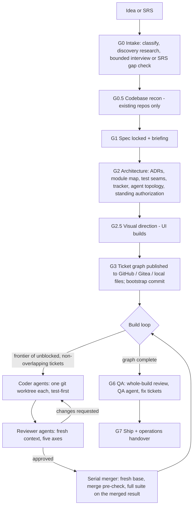

# Heimdall

Heimdall is an Agent Skill that takes a software idea, or a finished Software Requirements Specification, all the way to a shipped application. It runs the project the way a careful technical lead would: it researches what you do not know, asks only the questions that matter, locks a spec and an architecture with you, breaks the work into a ticket graph on GitHub or Gitea, and then drives a team of AI agents — researchers, test-first coders, independent reviewers, and a serial merger — until the release ships.

It is harness- and model-agnostic. The same skill runs in Claude Code, Codex CLI, Muse Code, OpenCode, pi, Gemini CLI, Antigravity CLI, Qwen Code, Mistral Vibe, Grok Build, Kimi Code CLI, Cursor, and GitHub Copilot, and it writes every prompt for the model family that will execute it: Claude, GPT and Codex, Muse, DeepSeek, Qwen, Gemini, Mistral, Grok, Kimi, GLM, and MiniMax.

**Install:** give your coding agent this repository's URL and ask it to follow [INSTALL.md](INSTALL.md). The repository is private, so the agent needs your GitHub access (`gh auth login`).

In Claude Code you can also install it directly:

```
/plugin install heimdall --marketplace soubarnak/Heimdall
```

## What it does

Heimdall picks one of three modes for each request and says which:

| Mode | For | What happens |
|---|---|---|
| **Build** | an app or feature from an idea, a PRD, or an SRS | decision gates G0–G7 and the multi-agent build loop |
| **Direct** | a small change in a coding harness | Heimdall does it itself, test-first, and reports |
| **Prompt** | an optimized prompt, a model recommendation, or a workflow plan | the 15-stage prompt pipeline with a 22-item checklist and a grade |

### Build mode



G1, G2, and G7 always need your sign-off; G6 does too in Production mode. Between gates the build loop runs on its own and reports progress in the tracker: one issue per ticket, status labels, one pull request per ticket, and the merge commit on every closed ticket.

### Research and decisions you can trust

- **Proactive research.** A Researcher agent runs at G0 (domain, competitors, constraints), at G2 (stack and architecture options), and per ticket when a library or API is unfamiliar. It prefers current primary documentation (Context7 where available), writes dated digests with sources, and runs small spikes when reading is not enough.
- **Architecture Decision Records.** Every significant G2 choice is researched, presented with a recommendation and its trade-offs, decided by you, and recorded as an ADR in `docs/adr/`.
- **Briefings.** At G1, G2, and G7 Heimdall tells you what was decided, which calls are yours, what you need to do (accounts, keys, domains), what you should learn to own the result, the risks and costs, and your next steps.
- **Advisor stance.** When a question rests on knowledge you do not have, Heimdall explains the options before asking you to choose. It never extracts a decision you are not equipped to make.

### Test-driven development

Coders build test-first at seams agreed at G2: one behavior per test, through public interfaces, mocks only at system boundaries. They leave red-first evidence (a failing-test commit before the implementation commit, and the failure messages in their report), and reviewers audit it — in Production, by running the new tests against the base code to prove they fail there. The protocol is adapted from Matt Pocock's `tdd` skill.

### Merge conflicts

Heimdall is designed so parallel agents rarely collide, and so the collisions that remain are caught before they land:

1. the architecture is planned for parallel work (module boundaries, discovery registries instead of shared lists, per-ticket migrations);
2. a scaffold ticket lands shared structure first;
3. every ticket declares a touch set, and shared hotspots (dependencies, schema, config, registries, styles, public APIs) are locked by one ticket at a time;
4. every coder works in its own git worktree;
5. branches are refreshed against the integration tip before review;
6. one merger lands changes in order, checks `git merge-tree` first, and runs the full test suite on the merged result before it lands;
7. any remaining conflict is classified and routed (mechanical fixes are made; semantic or design conflicts go back to a coder or to you).

This makes conflicts rare and mechanical. It does not make them impossible, and Heimdall never claims "zero conflicts guaranteed". Semantic conflicts — two changes that merge cleanly but break each other — are caught by the full suite on every merged result.

## Repository layout

```
skills/heimdall/            the skill (copy or link this folder into a harness)
  SKILL.md                  entry point: calibration, routing, Build mode overview, global rules
  references/               protocols loaded on demand (27 files)
  assets/                   templates for specs, tickets, packets, reports, ADRs, briefings, state (17 files)
scripts/install.sh          installs the skill into every detected harness
scripts/validate.sh         checks the skill format, index coverage, manifests, and secrets
.claude-plugin/             Claude Code plugin and marketplace manifests
docs/ADAPTATION_REPORT.md   how the original prompt bundle became this skill, and what was researched
INSTALL.md                  installation instructions for agents and humans
```

## Requirements

- An agent harness with a shell, and git 2.38 or later. Chat apps without tools can run the planning gates and hand the build loop to a coding agent.
- For GitHub tracking, the `gh` CLI signed in with `gh auth login`. For Gitea tracking, the `tea` CLI signed in with `tea login add`. Without either, tickets are local files.
- Parallel agents need a harness with subagents or a headless agent CLI. Without them Heimdall runs tickets one at a time.
- Containers, when a project needs them, use rootless podman.

## Origin

Heimdall started as a set of claude.ai Project knowledge files: a Claude-only prompt-optimization and orchestration bundle that handed work to coding agents by copy and paste. This repository turns it into one installable Agent Skill that runs the whole flow itself, in any harness, with any model family. [docs/ADAPTATION_REPORT.md](docs/ADAPTATION_REPORT.md) explains every change.

## Credits

- [mattpocock/skills](https://github.com/mattpocock/skills) (MIT): the test-first protocol, the spec and ticket shapes, and the review axes are adapted from its `tdd`, `to-spec`, `to-tickets`, `code-review`, and `implement-spec` skills. See [THIRD_PARTY_NOTICES.md](THIRD_PARTY_NOTICES.md).
- [obra/superpowers](https://github.com/obra/superpowers) and [EveryInc/compound-engineering-plugin](https://github.com/EveryInc/compound-engineering-plugin) informed the execution-framework guidance. Heimdall does not copy their text and does not depend on them.

## License

MIT. See [LICENSE](LICENSE).
