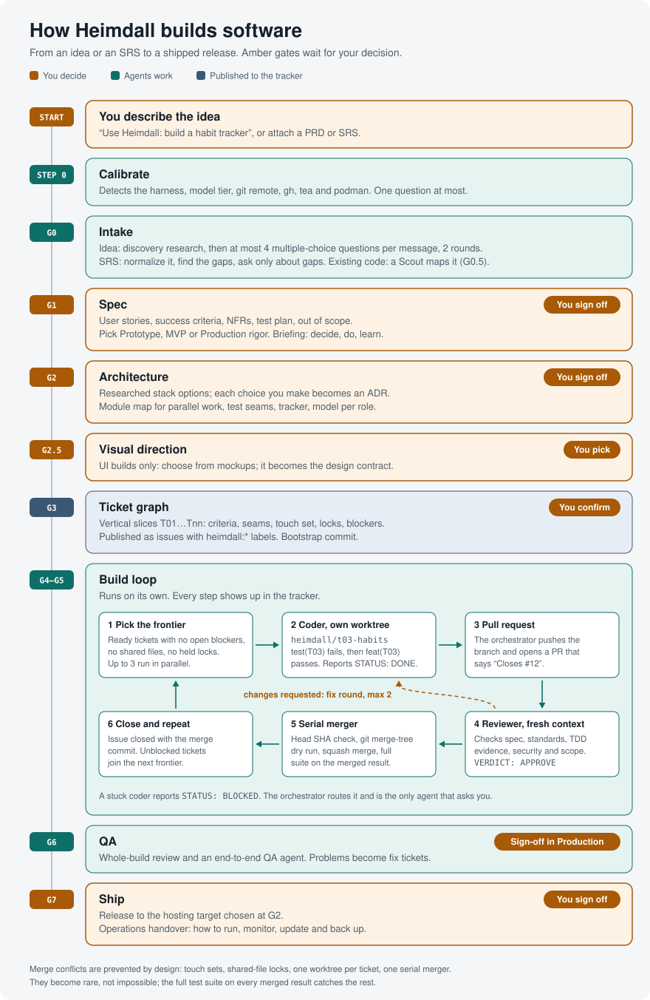

# Heimdall

Heimdall is an Agent Skill that takes a software idea, or a finished Software Requirements Specification, all the way to a shipped application. It runs the project the way a careful technical lead would: it researches what you do not know, asks only the questions that matter, locks a spec and an architecture with you, breaks the work into a ticket graph on GitHub or Gitea, and then drives a team of AI agents — researchers, test-first coders, independent reviewers, and a serial merger — until the release ships.

It is harness- and model-agnostic. The same skill runs in Claude Code, Codex CLI, Muse Code, OpenCode, pi, Gemini CLI, Antigravity CLI, Qwen Code, Mistral Vibe, Grok Build, Kimi Code CLI, Cursor, and GitHub Copilot, and it writes every prompt for the model family that will execute it: Claude, GPT and Codex, Muse, DeepSeek, Qwen, Gemini, Mistral, Grok, Kimi, GLM, and MiniMax.

## Install

Give your AI coding agent this repository's URL and say "install this skill". The steps below are written for that agent; people can follow them too. Full details, alternatives, and troubleshooting are in [INSTALL.md](INSTALL.md) ([raw](https://raw.githubusercontent.com/soubarnak/Heimdall/main/INSTALL.md)).

### Instructions for the installing agent

1. **Find your harness** in the table below: the tool you are running in, not the model. If you cannot tell, ask the user. If you have no shell or file tools (a chat app such as claude.ai, ChatGPT, or Meta AI), you cannot install skills; follow "Chat apps" in INSTALL.md instead.
2. **Run the install command** for your harness. The repository is public, so no credentials are needed. Use user scope (all projects) unless the user asks for one project only.
3. **Verify:** the file `SKILL.md` exists in the target folder and its frontmatter says `name: heimdall`.
4. **Tell the user** where you installed it, that skills load when a session starts so they must start a new session, and how to invoke it (last column). Mention the tracker setup in INSTALL.md if they want GitHub or Gitea issues.

Do not edit the skill files while installing, and do not install Docker; Heimdall uses rootless podman when a project needs containers.

### Install command per harness

The universal command works in every harness that can run bash (Linux, macOS, WSL, Git Bash). Replace `<harness>` with the value in the second column.

```bash
d="$HOME/.local/share/heimdall"
if [ -d "$d/.git" ]; then git -C "$d" pull --ff-only; else git clone --depth 1 https://github.com/soubarnak/Heimdall.git "$d"; fi
"$d/scripts/install.sh" --harness <harness>
```

| Harness | `<harness>` | Native alternative | Invoke with |
|---|---|---|---|
| Claude Code | `claude` | `claude plugin install heimdall --marketplace soubarnak/Heimdall` | `/heimdall` (plugin: `/heimdall:heimdall`) |
| Codex CLI | `codex` | `npx skills add soubarnak/Heimdall -g -a codex` | `$heimdall` or `/skills` |
| Muse Code | `muse` | `muse skills install "$d/skills/heimdall" --scope user` after cloning | `/heimdall` |
| OpenCode | `opencode` | — | ask "use Heimdall" |
| pi | `pi` | `pi install git:github.com/soubarnak/Heimdall` | `/heimdall` or ask |
| Gemini CLI | `gemini` | `gemini skills install https://github.com/soubarnak/Heimdall.git --path skills/heimdall --consent` | `/heimdall` or ask |
| Antigravity CLI | `agy` | — | ask "use Heimdall" |
| Qwen Code | `qwen` | — | `/heimdall` or ask |
| Mistral Vibe | `vibe` | — | ask "use Heimdall" |
| Grok Build | `grok` | — | ask "use Heimdall" |
| Kimi Code CLI | `kimi` | — | ask "use Heimdall" |
| Cursor | `cursor` | — | ask "use Heimdall" |
| GitHub Copilot | `copilot` | — | ask "use Heimdall" |

The script links the skill into `~/.agents/skills/heimdall`, which most harnesses read, plus `~/.claude/skills/heimdall` for Claude Code and `~/.qwen/skills/heimdall` for Qwen Code. `--harness all` installs every target; `--scope project --project-dir <dir>` copies the skill into one project instead; `--dry-run` shows what it would do; `--uninstall` removes it. Running the command again updates the skill.

On Windows without bash, in PowerShell (copies the skill; repeat to update):

```powershell
git clone --depth 1 https://github.com/soubarnak/Heimdall.git "$HOME\.local\share\heimdall"
foreach ($t in "$HOME\.agents\skills", "$HOME\.claude\skills") {
  New-Item -ItemType Directory -Force $t | Out-Null
  Remove-Item -Recurse -Force "$t\heimdall" -ErrorAction SilentlyContinue
  Copy-Item -Recurse "$HOME\.local\share\heimdall\skills\heimdall" "$t\heimdall"
}
```

## What it does

Heimdall picks one of three modes for each request and says which:

| Mode | For | What happens |
|---|---|---|
| **Build** | an app or feature from an idea, a PRD, or an SRS | decision gates G0–G7 and the multi-agent build loop |
| **Direct** | a small change in a coding harness | Heimdall does it itself, test-first, and reports |
| **Prompt** | an optimized prompt, a model recommendation, or a workflow plan | the 15-stage prompt pipeline with a 22-item checklist and a grade |

### Build mode

<p align="center">
  
</p>

G1, G2, and G7 always need your sign-off; G6 does too in Production mode. Between gates the build loop runs on its own and reports progress in the tracker: one issue per ticket, status labels, one pull request per ticket, and the merge commit on every closed ticket. A visual progress report, styled with the IBM Carbon Design System, shows what works so far, the build graph, the chosen design with its prototype screens, and the proposed next phase.

### Research and decisions you can trust

- **Proactive research.** A Researcher agent runs at G0 (domain, competitors, constraints), at G2 (stack and architecture options), and per ticket when a library or API is unfamiliar. It prefers current primary documentation (Context7 where available), writes dated digests with sources, and runs small spikes when reading is not enough.
- **Architecture Decision Records.** Every significant G2 choice is researched, presented with a recommendation and its trade-offs, decided by you, and recorded as an ADR in `docs/adr/`.
- **Briefings.** At G1, G2, and G7 Heimdall tells you what was decided, which calls are yours, what you need to do (accounts, keys, domains), what you should learn to own the result, the risks and costs, and your next steps.
- **Advisor stance.** When a question rests on knowledge you do not have, Heimdall explains the options before asking you to choose. It never extracts a decision you are not equipped to make.

### Test-driven development

Coders build test-first at seams agreed at G2: one behavior per test, through public interfaces, mocks only at system boundaries. They leave red-first evidence (a failing-test commit before the implementation commit, and the failure messages in their report), and reviewers audit it — in Production, by running the new tests against the base code to prove they fail there. The protocol is adapted from Matt Pocock's `tdd` skill.

### Merge conflicts

Heimdall is designed so parallel agents rarely collide, and so the collisions that remain are caught before they land:

1. the architecture is planned for parallel work (module boundaries, discovery registries instead of shared lists, per-ticket migrations);
2. a scaffold ticket lands shared structure first;
3. every ticket declares a touch set, and shared hotspots (dependencies, schema, config, registries, styles, public APIs) are locked by one ticket at a time;
4. every coder works in its own git worktree;
5. branches are refreshed against the integration tip before review;
6. one merger lands changes in order, checks `git merge-tree` first, and runs the full test suite on the merged result before it lands;
7. any remaining conflict is classified and routed (mechanical fixes are made; semantic or design conflicts go back to a coder or to you).

This makes conflicts rare and mechanical. It does not make them impossible, and Heimdall never claims "zero conflicts guaranteed". Semantic conflicts — two changes that merge cleanly but break each other — are caught by the full suite on every merged result.

## Usage

### Start

After installing, start a new session in your project folder and invoke Heimdall (the last column of the install table), or say "use Heimdall". Examples:

| You want | Say |
|---|---|
| An application from an idea | `/heimdall I want a habit tracker for my running club: members log runs and see streaks, and the coach gets a weekly summary.` |
| An application from a finished SRS | `/heimdall Build this.` and attach the SRS, or give its path (`docs/srs.pdf`) |
| A feature in an existing codebase | `/heimdall Add team workspaces to this app.` |
| A small change | `/heimdall Add CSV export to the reports page.` |
| A prompt for a specific model | `/heimdall Optimize this prompt for Gemini: <your prompt>` |

Heimdall first calibrates: it detects the harness, the model, and the tools available, and asks at most one question (usually your budget). Then it names the mode it picked — Build, Build-lite, Direct, or Prompt — and why. Say so if you want a different one. In an existing repository it maps the codebase first (G0.5), works on a `heimdall/<project-slug>` integration branch, and opens a release pull request to your default branch at the end.

### Answering questions

- Heimdall asks at most 4 questions per message and at most 2 rounds per gate, as multiple choice. Every question has exactly one recommended answer, listed first and marked "(Recommended)" with a one-line reason; this holds for gate questions, design picks, change requests, and questions from the build loop alike.
- When a question needs knowledge you do not have, it explains the options and recommends one before asking you to choose.
- Reply "Just proceed" at any point: it takes the recommended answers for everything you left open and records them as assumptions.
- For anything visual it shows mockups instead of asking.

### Gates: what you get and what you do

| Gate | You get | You do |
|---|---|---|
| G0 Intake | the classification, a discovery research digest, and a few questions (or a gap check of your SRS) | answer, or say "Just proceed" |
| G0.5 Recon (existing code only) | a short report on the codebase | confirm |
| G1 Spec | the spec with user stories and success criteria, its grade, the operating mode, and a briefing | **sign off**, or ask for changes |
| G2 Architecture | decision blocks with recommendations, ADRs, test seams, the tracker, the agent topology, the standing authorization, a setup packet, and a briefing | **sign off**; do the briefing's "What you need to do" items (accounts, keys set by name) |
| G2.5 Design (UI builds) | 2–3 mockups of the key screen, then a prototype of the core screens in the direction you picked | pick one; confirm the prototype |
| G3 Tickets | a numbered ticket list with dependencies and waves | confirm; Heimdall publishes the tickets and makes the bootstrap commit |
| G4–G5 Build loop | tracker updates and progress reports | nothing, unless it stops for you |
| G6 QA | a whole-build review and QA findings as new tickets | confirm (sign off in Production) |
| G7 Ship | the release steps and an operations handover briefing | **sign off**, and approve each deploy, tag, publish, or merge to your default branch |

A sign-off counts only when you give it after seeing the gate's artifacts. "Just build it" or "run all the gates" does not lock G1, G2, or G7: Heimdall stops there, shows the briefing with its recommended answers, and waits.

### Watching progress

- **Tracker:** one issue per ticket under a spec issue. Labels move from `heimdall:ready` to `heimdall:in-progress`, `heimdall:in-review`, and `heimdall:approved` or `heimdall:changes-requested`; a closed ticket carries its merge commit, and `heimdall:needs-human` marks a ticket waiting on you. Each ticket has one pull request with the coder's test-first evidence and the reviewer's verdict.
- **Progress report:** `.heimdall/progress.html` (open it in a browser) and `.heimdall/PROGRESS.md`. It shows the gate flow, what works so far, the build graph by wave, the chosen design with its mockups and prototype screens, what was done since the last report, and the proposed next phase. Heimdall refreshes it at every gate lock, after each merged wave, and whenever it stops for you, and, with GitHub or Gitea, posts the Markdown version as a comment on the spec issue. Say "Show progress" to refresh it at any time.
- **State:** `.heimdall/STATE.md` holds the ticket table, the work in flight, health counters, and the next action.

### When Heimdall stops for you

- **Questions from the build** (`needs-human`) are collected across tickets and asked together, at most 4 per message, each with a recommended answer. In an unattended run the other tickets keep moving; Heimdall stops only when nothing else can.
- **Health check:** when 2 of the last 4 merged tickets needed retries, a stronger model, or every allowed fix round, it pauses new work and reports the cause.
- **Revision loop:** when the build shows that the architecture or the ticket graph is wrong, it brings you back to G2 or G3.
- **Actions outside the standing authorization** (below) always wait for your go-ahead.

### Changes and bugs

- **Change your mind:** describe the change. Heimdall shows its cost (which tickets change, which are added, which merged work is affected), and you choose: amend the spec (a new spec version, new tickets, and a superseding ADR if the architecture moves) or park it in the backlog. It never absorbs a change silently.
- **Report a bug:** give the steps to reproduce it. It becomes a fix ticket: a reproducing test first, then the fix, through the same review and merge. No gates are reopened.
- New work on a project that already has `.heimdall/STATE.md` always enters one of these two ways, never as a fresh build.

### Pausing and resuming

- Heimdall saves STATE.md at every gate lock and every ticket status change. Say "Checkpoint now" to save it immediately.
- To resume, open a new session in the project — any harness, any model — and invoke Heimdall. It reads STATE.md, re-checks the environment, reconciles with the tracker (the tracker wins), and continues where it stopped.
- Start a fresh session after G2, after G3, and every few merges on a tight budget.
- Do not switch the model or effort in the middle of a session. If you must, tell Heimdall so it recalibrates.

### What Heimdall does without asking

At G2 you approve a standing authorization. With it, the build loop creates and labels issues, milestones, and comments; pushes `heimdall/*` branches and deletes them once merged; pushes the integration branch (the bootstrap commit and each merge); opens pull requests; merges approved pull requests into the integration branch; closes tickets; and reverts a breaking merge with a new commit.

Everything else waits for your explicit go-ahead, every time: force-pushes, deleting data or non-Heimdall branches, migrations without a backup, merging or pushing to the default branch when it is not the integration branch, deploying, tagging, publishing, changing repository settings, spending money, and sending messages. If you want to approve every push, say so: Heimdall then merges locally and pushes only at checkpoints you approve.

Secrets stay out of everything Heimdall writes. It names them ("set STRIPE_SECRET_KEY in .env") and never reads their values; if you paste one, it flags it, leaves it out, and advises you to rotate it.

### Rigor, size, and speed

- **Operating mode** (chosen at G1): Prototype favors speed (G1 and G2 together, relaxed test-first rules); MVP is the default; Production adds full gates, a reviewer from a different model family when available, a red-at-base test check on every ticket, and a mandatory G6.
- **Build-lite:** for 1–3 tickets. G1 and G2 are signed off together, tickets default to local files, and one coder works at a time; it is still test-first and still reviewed.
- **Parallelism:** up to 3 coders at once by default (up to 5 with a generous budget). Reviewers do not count toward the cap, and merges are always one at a time. Without subagents or a headless agent CLI, Heimdall works through tickets one by one.
- **Tracker:** GitHub (`gh auth login`), Gitea (`tea login add`), or local files when neither is available.

### Files Heimdall writes

```
.heimdall/                runtime state; listed in .git/info/exclude, never committed
  STATE.md                the resume point
  progress.html           the visual progress report; PROGRESS.md is the Markdown version
  spec.md  HANDOFF.md  DECISIONS.md
  research/  briefings/   research digests and your briefings
  design/                 mockups, the prototype, and screenshots
  tickets/  packets/  reports/
docs/adr/                 committed: architecture decision records
AGENTS.md (+ CLAUDE.md)   committed: commands, module map, and conventions for every coding agent
```

### Chat apps

In a chat app without file tools (claude.ai, ChatGPT, Meta AI), Heimdall runs G0–G3 in the chat and prints every artifact in full. It starts with a Session Plan, and each chat ends with the updated STATE.md and an instruction to paste it into a fresh chat. After G3 it gives you a kickoff message that hands the build loop to a coding agent with Heimdall installed: which files to save where, the install command, and the first message to send. Progress reports appear as Markdown, or as an artifact where the app supports artifacts.

## Repository layout

```
skills/heimdall/            the skill (copy or link this folder into a harness)
  SKILL.md                  entry point: calibration, routing, Build mode overview, global rules
  references/               protocols loaded on demand (27 files)
  assets/                   templates for specs, tickets, packets, reports, ADRs, briefings, state, progress report, QA, research, kickoff, AGENTS.md (23 files)
scripts/install.sh          installs the skill into every detected harness
scripts/validate.sh         checks the skill format, index coverage, manifests, and secrets
.claude-plugin/             Claude Code plugin and marketplace manifests
docs/ADAPTATION_REPORT.md   how the original prompt bundle became this skill, and what was researched
docs/assets/build-flow.svg  the Build mode diagram shown above
INSTALL.md                  installation instructions for agents and humans
```

## Requirements

- An agent harness with a shell, and git 2.38 or later. Chat apps without tools can run the planning gates and hand the build loop to a coding agent.
- For GitHub tracking, the `gh` CLI signed in with `gh auth login`. For Gitea tracking, the `tea` CLI signed in with `tea login add`. Without either, tickets are local files.
- Parallel agents need a harness with subagents or a headless agent CLI. Without them Heimdall runs tickets one at a time.
- Containers, when a project needs them, use rootless podman.

## Origin

Heimdall started as a set of claude.ai Project knowledge files: a Claude-only prompt-optimization and orchestration bundle that handed work to coding agents by copy and paste. This repository turns it into one installable Agent Skill that runs the whole flow itself, in any harness, with any model family. [docs/ADAPTATION_REPORT.md](docs/ADAPTATION_REPORT.md) explains every change.

## Credits

- [mattpocock/skills](https://github.com/mattpocock/skills) (MIT): the test-first protocol, the spec and ticket shapes, and the review axes are adapted from its `tdd`, `to-spec`, `to-tickets`, `code-review`, and `implement-spec` skills. See [THIRD_PARTY_NOTICES.md](THIRD_PARTY_NOTICES.md).
- [obra/superpowers](https://github.com/obra/superpowers) and [EveryInc/compound-engineering-plugin](https://github.com/EveryInc/compound-engineering-plugin) informed the execution-framework guidance. Heimdall does not copy their text and does not depend on them.

## License

MIT. See [LICENSE](LICENSE).
