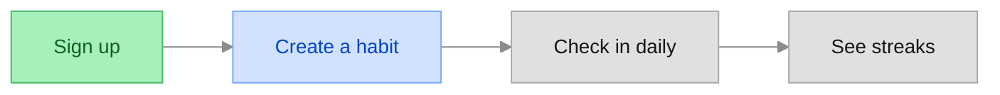
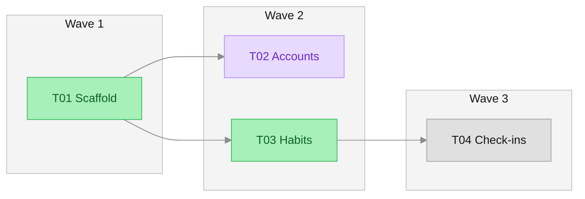

# PROGRESS — <project-slug> — <YYYY-MM-DD> — <phase, e.g. "G3 locked" or "build loop, wave 2 of 4">

<!-- The visual progress report (references/production-orchestrator.md, section 6). Regenerate it from STATE.md,
     HANDOFF.md, the spec's US → T table, and the tracker; never hand-edit it. The tracker wins on ticket status.
     Every "done" item cites a gate lock date, an ADR, or a merge SHA and PR. No secrets, code, or diffs.
     Agent profile: save as .heimdall/PROGRESS.md and post it as a comment on the spec issue (GitHub, Gitea).
     Chat profile: show it in full. Keep it under 90 lines, diagrams included.
     Mermaid: the `init` line, `flowchart`, `classDef`, and `class` only (no `click`, no HTML labels, no parentheses
     in labels), so GitHub and Gitea render it. Styling follows the IBM Carbon Design System, white theme: IBM Plex Sans,
     gray 10 groups, gray 50 lines, and Carbon tag tokens for status (background 20, border 40, text 70 of one hue; gray text is gray 100):
     green done, blue in progress, purple in review, gray not started, and the warning notification colors
     (yellow 10, yellow 30) for waiting on the user. Keep the init line and these classDefs unchanged in every report. -->

**<closed>/<total> tickets merged · <n> in flight · <n> waiting on you** · spec v<N> · HANDOFF v<N> · Heimdall v<version>

## Where we are

```mermaid
%%{init: {"theme": "base", "themeVariables": {"fontFamily": "IBM Plex Sans, Helvetica Neue, Arial, sans-serif", "fontSize": "14px", "primaryColor": "#f4f4f4", "primaryTextColor": "#161616", "primaryBorderColor": "#8d8d8d", "lineColor": "#8d8d8d", "clusterBkg": "#f4f4f4", "clusterBorder": "#c6c6c6", "titleColor": "#161616"}}}%%
flowchart LR
  G0[G0 Intake] --> G1[G1 Spec] --> G2[G2 Architecture] --> G25[G2.5 Design] --> G3[G3 Tickets] --> G45[G4-5 Build] --> G6[G6 QA] --> G7[G7 Ship]
  classDef done fill:#a7f0ba,stroke:#42be65,color:#0e6027
  classDef current fill:#d0e2ff,stroke:#78a9ff,color:#0043ce
  classDef next fill:#e0e0e0,stroke:#a8a8a8,color:#161616
  class G0,G1,G2 done
  class G25 current
  class G3,G45,G6,G7 next
```

<!-- Drop G25 for builds without a UI, and G0.5 never appears. Build-lite: G1 and G2 are one node, "G1-2 Spec and architecture". -->

## What works so far

<!-- The user journey: the spec's user stories in the order a user meets them, at most 8 nodes (merge small stories).
     A story is built when every ticket that covers it (the US → T table) is merged. Before G3 every story is planned. -->

## Build graph

<!-- From G3 on. One subgraph per wave; edges only for blocking relationships. With more than 20 tickets,
     draw one node per wave with counts instead, for example W3[Wave 3: 4 of 6 merged]. -->

Legend: green merged · purple in review · blue in progress · gray ready or blocked · yellow waiting on you

## Design

<!-- UI-bearing builds, from the G2.5 lock on; omit the section otherwise. Paths are local to the project. -->

Chosen: **<option name>** — <one line: palette, type feel, density, layout>. Confirmed <YYYY-MM-DD>.
- Prototype: `.heimdall/design/prototype/index.html` — <n> screens: <screen names>
- Options shown: `option-a.html` <one line> · `option-b.html` chosen · `option-c.html` <one line>
- Screenshots: `.heimdall/design/shots/` <or "none: no headless browser; open the HTML files">
- Built against the prototype: <screens shipped so far, each with its UI ticket and screenshot path, or "no UI ticket merged yet">

## Done since the last report
- <G2 locked YYYY-MM-DD: <stack in plain words> (ADR 0001–0004)>
- <T03 Habits — merged a1b2c3d via #14: users can create, rename, and archive habits>

## Next phase (proposed)
<The next gate or the next wave, in plain language: what it will deliver and roughly how many tickets.>
- <T04 Check-ins — ready: users check in once a day; blocked by nothing>
- Waiting on you: <each needs-human item with a recommended answer, or "nothing">
- Risks: <one line, or "none">

## Your next steps
1. <…>
